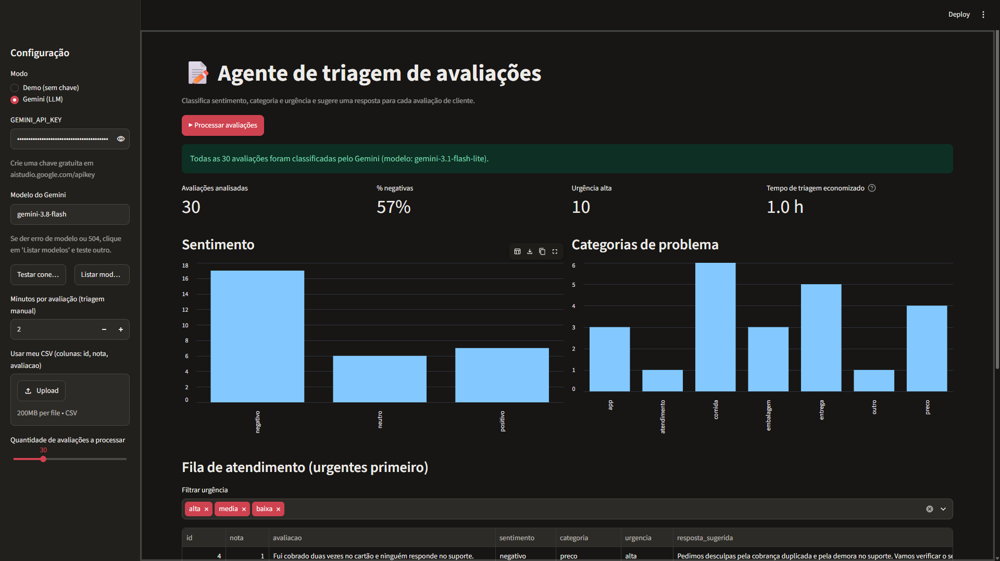
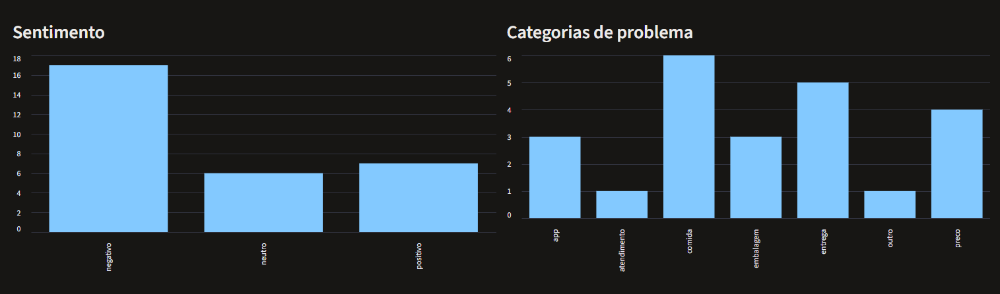
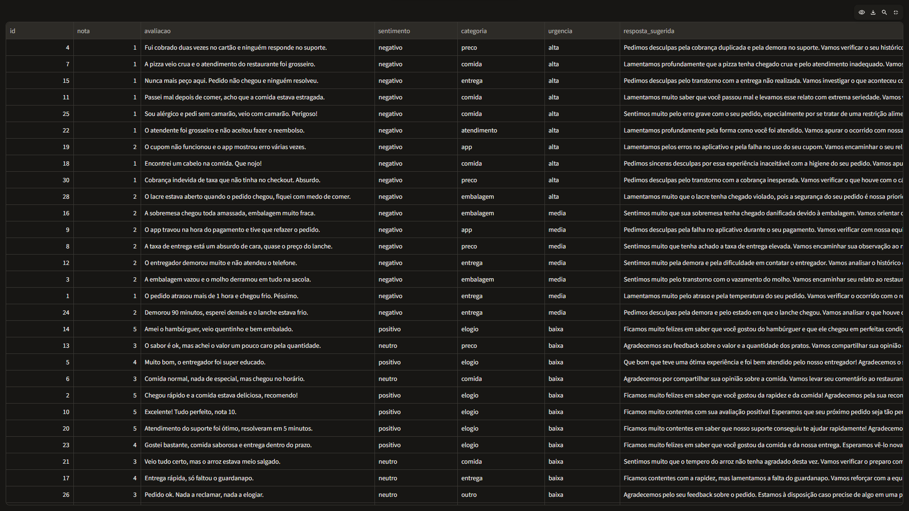

# 📝 Agente de triagem de avaliações com IA





Agente que lê avaliações de clientes de um app de delivery e, para cada uma, devolve **sentimento**, **categoria do problema**, **urgência** e uma **resposta sugerida**. Os resultados aparecem num dashboard com uma fila de atendimento que mostra os casos urgentes primeiro.

## O problema

Times de operações recebem milhares de avaliações por dia. Ler, classificar e responder cada uma à mão é lento, e casos graves (alergia, comida estragada, cobrança indevida) podem ficar perdidos no meio dos demais.

## A solução

1. O usuário envia um CSV (`id, nota, avaliacao`) ou usa os dados de exemplo.
2. Um LLM (Gemini) classifica cada avaliação seguindo um prompt com saída em JSON.
3. A saída é **validada em código**: valores fora do esperado são corrigidos, e se a API falhar o sistema cai para o modo de regras em vez de quebrar.
4. O dashboard mostra indicadores, gráficos e a fila ordenada por urgência, com opção de baixar o CSV classificado.

```
CSV ─► agent.py ─► Gemini (ou modo demo) ─► validação ─► app.py (Streamlit) ─► CSV classificado
```

## Dois modos de uso

| Modo | Precisa de chave? | O que faz |
|------|-------------------|-----------|
| **Demo** | Não | Classificador simples por palavras-chave. Serve para testar a interface e o fluxo. **Não é IA** e erra casos sutis. |
| **Gemini** | Sim (gratuita) | Usa um LLM para classificar e escrever as respostas. |

## Como rodar

```bash
git clone <url-do-seu-repositorio>
cd review-agent
python -m venv .venv && source .venv/bin/activate   # no Windows: .venv\Scripts\activate
pip install -r requirements.txt
streamlit run app.py
```

Para usar o Gemini:
1. Crie uma chave gratuita em https://aistudio.google.com/apikey
2. Copie `.env.example` para `.env` e cole a chave (ou digite na barra lateral do app).
3. No app, escolha o modo **Gemini (LLM)**.

Testes: `pytest`

## Sobre as métricas

O indicador de "tempo economizado" é uma **estimativa**: número de avaliações × minutos de triagem manual (padrão: 2 min, ajustável na barra lateral). Não é uma medição real. Os dados em `data/reviews.csv` são **fictícios**, escritos para demonstração.

## Limitações

- O modo demo usa regras simples e não entende ironia nem contexto.
- As respostas sugeridas devem passar por revisão humana antes de serem enviadas.
- Ainda não há avaliação formal de acurácia com um conjunto rotulado.

## Próximos passos

- Medir acurácia do LLM contra avaliações rotuladas à mão.
- Automatizar a entrada de avaliações com n8n ou um webhook.
- Registrar casos de urgência alta num canal de alerta (Slack/e-mail).
- Fazer o deploy no Streamlit Community Cloud.

## Stack

Python · Streamlit · pandas · Google Gemini API · pytest
